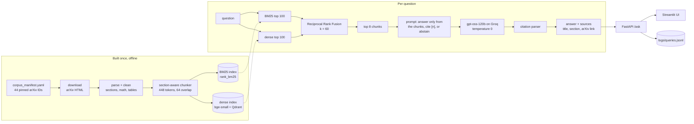

# PaperRAG

**An evaluated retrieval-augmented question-answering system over 44 AI/ML research papers.**


PaperRAG answers questions about 44 AI/ML research papers with citations to the exact passages
it used, and says *"I couldn't find sufficient evidence in the available sources."* when the
papers don't contain the answer. It is plain Python (no LangChain or LlamaIndex), uses free-tier
models only, and runs on a laptop CPU.

## How it works



- **Chunking:** section-aware chunks sized in tokens of the embedding model's own tokenizer.
- **Retrieval:** hybrid BM25 + dense search, fused with Reciprocal Rank Fusion; the top 8 chunks go to the model.
- **Generation:** the prompt requires `[n]` citations to the chunks, or the exact abstention sentence.
- **Serving:** a FastAPI API and a Streamlit UI, packaged with Docker.

## Results

The question set was fixed before any tuning, the retrieval setup was chosen on a dev split,
and the final system was run once on a held-out test split (36 questions).

| Recall@10 | MRR | Abstention accuracy | Faithfulness | Relevance | Generation latency p50 |
|---|---|---|---|---|---|
| 0.655 | 0.438 | 0.861 | 0.958 | 1.000 | 772 ms |

Full results, confidence intervals, the setup comparison and the error analysis are in [reports/](reports/).

## Run it

Windows PowerShell, Python 3.11, and a free [Groq API key](https://console.groq.com/keys):

```powershell
py -3.11 -m venv .venv; .\.venv\Scripts\Activate.ps1
python -m pip install -e ".[dev]"
Copy-Item .env.example .env    # put your GROQ_API_KEY in .env
python -m ragpapers.ingest.download; python -m ragpapers.ingest.parse; python -m ragpapers.chunking.build
uvicorn ragpapers.api.app:app --port 8000            # API: http://localhost:8000/docs (first start builds the indexes)
streamlit run src/ragpapers/ui/app.py                # UI: http://localhost:8501 (second terminal)
```

With Docker Desktop, after building the corpus and indexes: `docker compose up --build`

## Stack

bge-small-en-v1.5 · Qdrant · rank_bm25 · gpt-oss-120b on Groq · FastAPI · Streamlit · Docker · GitHub Actions
